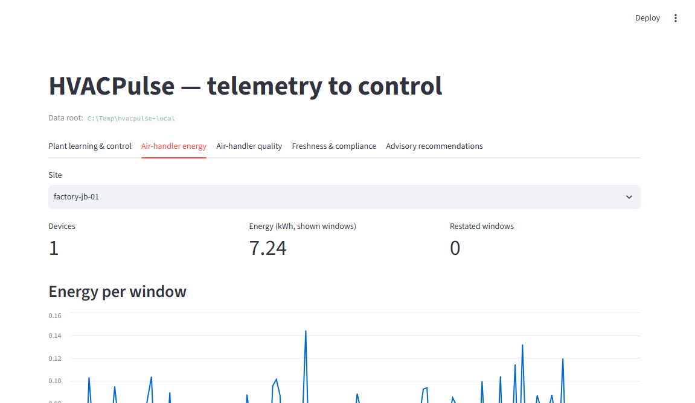

# HVACPulse: Streaming Telemetry, Learning and Mock Control

[](https://github.com/jerry98s/hvacpulse-streaming-platform/actions/workflows/ci.yml)

## Proof / Run Evidence

| Signal | What to check |
|---|---|
| **CI** | The badge above. Every push to `main` runs Ruff, unit tests, Spark and Delta suites, dashboard render tests, a live Kafka-to-mock-control integration test, both Avro compatibility checks, and Terraform fmt/validate. |
| **Tests** | `uv run pytest tests/unit -m unit` → **142 passed** locally; Spark, Delta, dashboard and Kafka suites run as separate CI jobs. |
| **Idempotent writes** | `tests/delta/test_job_idempotency.py` retries and replays the quarantine, Gold history and restatement MERGEs and checks no row is duplicated. |
| **Restatement** | Gold `OPEN → FINAL → RESTATED` with `metric_version` + `_content_hash`; a corrected window keeps prior versions in `gold_hvac_metrics_history`. |
| **Safety gates** | A mock control decision is `BLOCKED` when any gate fails (e.g. `reason=MODEL_NOT_APPROVED`, `plan=null`); nothing actuates equipment. |
| **Contracts** | `contracts/check_compatibility.py` enforces transitive backward compatibility across all retained Avro versions in CI. |

**Verify it yourself** (three commands, no secrets needed):

```powershell
uv sync --group dev --group dashboard
uv run pytest tests/unit -m unit
.\scripts\local\run_local_stack.ps1 -Task all
```

The dashboard below reads the Delta tables directly over delta-rs (no Spark session):



## Executive Summary

HVACPulse collects HVAC telemetry, builds trustworthy streaming features, trains cooling-load models, and evaluates constrained control plans against a mock plant. Kafka and Delta Lake are the shared backbone; there is no separate offline pilot pipeline.

The platform simulates HVAC events produced by Building Management Systems, IoT gateways and equipment sensors. Events are ingested through Apache Kafka locally and Azure Event Hubs' Kafka-compatible endpoint in Azure. Spark Structured Streaming and Databricks Lakeflow process the data into Delta Lake Bronze, Silver, Quarantine and Gold layers.

The resulting datasets support:

- Real-time HVAC monitoring
- Energy-consumption analysis
- Sensor and equipment-health detection
- Data-quality observability
- Auditable AI recommendations
- Historical replay and model development

The project demonstrates production-oriented Kafka, Spark Streaming, Delta Lake, Lakeflow, Unity Catalog, data quality, schema evolution, failure recovery, cost-aware scaling and cloud deployment.

The primary plant flow is:

```text
Mock raw tags → Avro/Kafka → immutable Bronze → validated plant Silver
  → streaming features + measured labels → chronological model training
  → current-load estimation → constrained plan → shadow / simulated ACK
  └──────────────── next mock telemetry reflects the ACKed plan ──────┘
```

The existing air-handler Avro v1/v2, quality and Gold jobs remain supported on
the same backbone. Plant snapshots have their own Avro record family and table
grain; water-loop measurements are not forced into air-temperature columns.
See [the plant pipeline runbook](docs/runbooks/plant-pipeline.md) for contracts,
commands, safety boundaries and migration from the removed `pilot` runner.

```powershell
uv sync --group dev --group dashboard
.\scripts\local\run_local_stack.ps1 -Task plant-all
# Opt in to simulated acknowledgements and feedback; never physical control:
.\scripts\local\run_local_stack.ps1 -Task plant-cycle -SimulateControl
```

---

## Business Problem

Industrial HVAC optimization depends on high-quality, timely sensor data.

In pharmaceutical plants, semiconductor facilities and precision-manufacturing environments, HVAC systems must reduce energy consumption while maintaining strict temperature, humidity, airflow and pressure requirements.

Real-world sensor data can be:

- Late or out of order
- Duplicated by gateway retries
- Missing required measurements
- Structurally invalid after firmware changes
- Produced by disconnected, frozen or drifting sensors
- Physically inconsistent with equipment state
- Replayed after pipeline recovery
- Delivered using different units or schema versions

Using unreliable telemetry directly can produce incorrect energy calculations, unreliable AI predictions, false equipment alerts, unsafe control recommendations, environmental-compliance violations, difficulty proving customer energy savings, and loss of operator trust.

HVACPulse addresses this problem by creating a reliable data foundation between physical equipment and downstream analytics or AI systems.

---

## Project Objective

The platform must:

1. Ingest high-volume HVAC telemetry continuously.
2. Preserve every source event for audit and replay.
3. Validate schema, range, freshness and physical consistency.
4. Handle duplicate, late and out-of-order events.
5. Recover from pipeline failures without corrupting results.
6. Support controlled firmware-driven schema changes.
7. Produce real-time energy and equipment-health metrics.
8. Block advisory recommendations when input data is unsafe.
9. Provide lineage, quality metrics and operational monitoring.
10. Run from one shared PySpark codebase locally and on Azure Databricks.
11. Treat cost as a first-class design constraint at scale.
12. Distinguish provisional, finalized and restated results when corrections arrive late.

---

## Architecture

**Local development:**

```
Python HVAC Simulator
    → Apache Kafka
    → Spark Structured Streaming
    → Local Delta Lake
    → Local tests and dashboards
```

**Azure deployment:**

```
Python HVAC Simulator
    → Avro + Azure Schema Registry
    → Azure Event Hubs Kafka Endpoint
    → Azure Databricks Lakeflow
    → Bronze Delta on ADLS Gen2
    → Silver History / Silver Current / Quarantine
    → Gold Current / Gold History / Recommendations
    → Unity Catalog
    → Databricks SQL consumers (dashboard asset planned)
```

**Azure responsibilities**

- Azure Event Hubs provides Kafka-compatible event ingestion.
- Azure Schema Registry manages Avro contracts for the cloud deployment.
- Azure Databricks provides Spark, Lakeflow, Delta Lake and SQL analytics.
- ADLS Gen2 provides durable object storage.
- Unity Catalog provides governance, ownership and lineage.
- Azure Key Vault or Databricks secret scopes protect credentials.
- Declarative Automation Bundles deploy pipelines and jobs.

Apache Kafka remains part of the local implementation so the project demonstrates native Kafka topics, offsets, partitions, consumer groups and replay behaviour.

---

## Source Data

### HVAC Telemetry

Each event represents an equipment snapshot:

```json
{
  "event_id": "evt-01J9Z81M8A",
  "logical_event_id": "evt-01J9Z81M8A",
  "revision_number": 1,
  "supersedes_event_id": null,
  "schema_id": 1001,
  "schema_version": 1,
  "firmware_version": "2.4.1",
  "event_time": "2026-08-26T10:15:03.245Z",
  "gateway_id": "gateway-kl-01",
  "device_id": "ahu-001",
  "boot_id": "boot-20260826-01",
  "sequence_number": 184920,
  "site_id": "factory-kl-01",
  "zone_id": "cleanroom-a",
  "measurements": {
    "supply_air_temp_c": 13.8,
    "return_air_temp_c": 23.6,
    "zone_temp_c": 24.2,
    "relative_humidity_pct": 57.4,
    "airflow_m3h": 8200.0,
    "static_pressure_pa": 410.0,
    "fan_speed_pct": 72.0,
    "chilled_water_valve_pct": 64.0,
    "power_kw": 18.7
  },
  "operating_state": {
    "mode": "AUTO",
    "temperature_setpoint_c": 23.0,
    "equipment_running": true
  }
}
```

The JSON above is the human-readable logical representation. Events are serialized as Avro on the Kafka/Event Hubs wire path, with the schema identity carried in the event metadata.

The simulator deliberately generates valid telemetry, duplicate events, late events, out-of-order events, missing values, impossible measurements, frozen sensors, sequence gaps, unknown equipment, unsupported schema versions and conflicting duplicate payloads.

### Equipment Master Data

A reference table contains site and equipment identity, equipment type, rated power, valid environmental limits, expected reporting frequency, sensor calibration information and equipment commissioning status. Equipment-specific limits remain in reference data rather than application code.

---

## Medallion Data Model

### Bronze

Bronze is an immutable raw-event layer. It stores the raw Kafka key and payload, Kafka topic/partition/offset, Kafka timestamp, schema and firmware version, ingestion timestamp, parse status, and a payload hash.

Bronze retains valid, invalid and unparseable records. It is the long-term system of record for audit, replay and historical reprocessing. Kafka provides short-term operational replay; Bronze provides long-term analytical and recovery replay.

> **Note:** edge-side volume reduction (see Cost and Scaling Strategy) only ever discards data before it reaches the gateway. Once an event is emitted by the gateway, Bronze preserves it unconditionally — the audit guarantee applies to everything that reaches Kafka, not to raw sensor sampling that was never transmitted.

### Silver

Silver separates validated event history from the latest corrected business state:

- `silver_telemetry_history` is append-only and keyed by the physical `event_id`. It preserves every valid event revision.
- `silver_telemetry_current` is keyed by `logical_event_id` and selects the highest valid `revision_number`.

Processing includes explicit schema parsing, type validation, equipment enrichment, event-time watermarking, exact-retry deduplication, physical-plausibility validation, standardised units and processing-latency calculation. Only structurally valid and physically plausible events enter Silver.

Sequence gaps, sensor freshness, environmental-limit violations and cross-field equipment inconsistencies are retained as operational signals rather than automatically treated as corrupt data.

### Quarantine

Rejected events are retained with explainable error codes:

```
SCHEMA_INVALID
UNSUPPORTED_SCHEMA_VERSION
EQUIPMENT_UNKNOWN
TEMPERATURE_PHYSICALLY_IMPOSSIBLE
HUMIDITY_MISSING
NEGATIVE_POWER
EVENT_TOO_LATE
IDEMPOTENCY_CONFLICT
UNIT_CONVERSION_FAILED
```

Quarantine preserves the original payload, validation results and processing context.

Operational conditions such as `SENSOR_STALE`, `SEQUENCE_GAP`, `ENVIRONMENTAL_LIMIT_VIOLATION` and `EQUIPMENT_STATE_INCONSISTENT` are written to equipment-health or compliance outputs. A valid but alarming measurement must remain available to operators rather than being discarded as bad data.

### Gold

Gold contains one-minute per-equipment energy metrics, five-minute quality and
compliance windows, equipment-health indicators, sensor-freshness metrics,
data-quality scorecards and advisory recommendation eligibility. Five-minute
site energy aggregation and production baseline/cost-avoidance jobs are not
implemented. Plant Gold adds instantaneous feature/label rows, current-load
estimates and durable mock-control decisions. There is no verified savings job.

### Metadata and Semantic Layer

`reference/semantic_model.yml` is the single definition of every table: description, grain, keys,
layer and domain, and a description for every column. It also defines the business metrics as
Databricks metric views, so energy, data quality, compliance and freshness have one governed
definition each. `reported_energy_kwh` counts FINAL and RESTATED windows only, so it is the figure
for customer reports.

`streaming.jobs.semantic_layer` (`-Task semantic` locally, task `semantic_layer` in the bundle)
fails if any existing table has an undocumented or missing column. On Unity Catalog it then applies
table comments, column comments and `layer`/`domain`/`owner` tags, and creates the metric views
(YAML spec 1.1; needs a Unity Catalog SQL warehouse or a recent runtime). Bronze keeps the
comment set by the Lakeflow pipeline, which owns its metadata. Query a metric view with
`SELECT site_id, MEASURE(reported_energy_kwh) FROM mv_hvac_energy GROUP BY site_id`.

After changing the model, regenerate the dictionary below with
`python -m streaming.semantic --write-readme`; a unit test fails if it is stale.

<!-- BEGIN DATA DICTIONARY (generated from reference/semantic_model.yml) -->

| Table | Layer | Grain | Key | Description |
|---|---|---|---|---|
| `bronze_telemetry` | bronze | one row per Kafka record | `topic`, `partition`, `offset` | Raw Kafka or Event Hubs records for both telemetry profiles, append-only and immutable. |
| `silver_telemetry_history` | silver | one row per event_id | `event_id` | Validated air-handler readings, every revision kept. |
| `silver_telemetry_current` | silver | one row per logical_event_id | `logical_event_id` | Latest valid revision of each logical reading, rebuilt from history. |
| `quarantine_events` | quarantine | one row per rejected Kafka record | `_dedup_id`, `payload_hash` | Corrupt or unprocessable air-handler records with a typed error code. Alarming but valid data is never quarantined. |
| `gold_hvac_metrics_current` | gold | one row per site_id, device_id and one-minute window_start | `site_id`, `device_id`, `window_start` | Latest published one-minute metrics per device. Customer reporting uses FINAL and RESTATED windows. |
| `gold_hvac_metrics_history` | gold | one row per site_id, device_id, window_start and metric_version | `site_id`, `device_id`, `window_start`, `metric_version` | Every published version of every one-minute metric window, append-only, so past reports can be reproduced. |
| `gold_data_quality_scorecard` | gold | one row per site_id, device_id and five-minute window_start (ingest time) | `site_id`, `device_id`, `window_start` | Data quality per device and five-minute ingest window, valid versus quarantined records and null rates. |
| `gold_sensor_freshness` | gold | one row per device_id | `device_id` | Staleness of each device against its expected report interval. |
| `gold_compliance` | gold | one row per site_id, device_id and five-minute window_start (event time) | `site_id`, `device_id`, `window_start` | Readings outside facility temperature and humidity limits per device and five-minute event window. |
| `gold_equipment_health` | gold | one row per site_id and device_id | `site_id`, `device_id` | Cross-field inconsistencies per device over current Silver; valid readings that cannot all be true together. |
| `gold_recommendations` | gold | one row per recommendation_id | `recommendation_id` | Advisory optimisation suggestions that passed every safety gate. Never a control action. |
| `recommendation_events` | audit | one row per event_type and recommendation_id | `event_type`, `recommendation_id` | Compensating events that revoke recommendations whose source window was restated. |
| `late_corrections` | audit | one row per event_id and revision_number | `event_id`, `revision_number` | Revisions that arrived after the watermark and may affect FINAL Gold windows. |
| `metric_restatement_events` | audit | one row per device_id, window_start and metric_version | `device_id`, `window_start`, `metric_version` | Gold versions that restated a FINAL window; provisional OPEN updates are excluded. |
| `silver_plant_snapshots` | silver | one row per plant snapshot | `row_id` | Validated mock plant snapshots with calibrated tag values. |
| `quarantine_plant_snapshots` | quarantine | one row per rejected plant snapshot | `row_id` | Mock plant snapshots that failed contract, scope or freshness checks. |
| `gold_plant_features` | gold | one row per eligible plant snapshot | `row_id` | Point-in-time plant features and targets for cooling-load models. |
| `plant_model_registry` | ml | one row per model_id | `model_id` | Trained mock plant models with gate results; only approved models may forecast. |
| `gold_plant_predictions` | gold | one row per prediction_id | `prediction_id` | Cooling-load estimates from approved models. |
| `gold_plant_control_decisions` | gold | one row per decision_id | `decision_id` | Constrained control decisions for the mock plant; shadow by default, never physical actuation. |

**Metric views** (Databricks `WITH METRICS`; query with `MEASURE(<name>)`):

| View | Source | Dimensions | Measures |
|---|---|---|---|
| `mv_hvac_energy` | `gold_hvac_metrics_current` | `site_id`, `device_id`, `window_status`, `window_date`, `window_hour` | `energy_kwh`: Energy in kWh including provisional OPEN windows.<br>`reported_energy_kwh`: Energy in kWh from FINAL and RESTATED windows only; the customer reporting figure.<br>`readings`: Valid readings aggregated.<br>`avg_power_kw`: Reading-weighted mean power in kilowatts.<br>`peak_power_kw`: Highest instantaneous power in kilowatts.<br>`restated_windows`: Windows whose FINAL value was later corrected. |
| `mv_data_quality` | `gold_data_quality_scorecard` | `site_id`, `device_id`, `dq_status`, `window_date` | `received_events`: Records received.<br>`valid_events`: Records that reached Silver.<br>`quarantined_events`: Records quarantined.<br>`quality_rate`: Share of received records that were valid.<br>`failing_windows`: Five-minute windows with quality_score below 0.9. |
| `mv_compliance` | `gold_compliance` | `site_id`, `device_id`, `window_date` | `violation_minutes`: Minutes outside limits.<br>`temp_violation_events`: Readings outside temperature limits.<br>`humidity_violation_events`: Readings outside humidity limits.<br>`readings`: Readings evaluated. |
| `mv_sensor_freshness` | `gold_sensor_freshness` | `site_id`, `commissioning_status` | `devices`: Devices observed.<br>`stale_devices`: Devices silent for over three report intervals.<br>`max_age_seconds`: Longest time since a device last reported. |

Column descriptions for every table live in `reference/semantic_model.yml` and are applied
to Unity Catalog as column comments.

<!-- END DATA DICTIONARY -->

### Sample Data

A local run writes the air-handler tables; the plant tables come from the plant
loop (locally from a Delta test run). Seventeen tables hold rows. Three audit
tables are empty until the pipeline emits their events: `late_corrections` and
`metric_restatement_events` exist with zero rows in the demo run (all Gold
windows were still `OPEN`, so nothing restated), and `recommendation_events` is
only created when a recommendation is first revoked.

| Table | Rows (demo) | Shape |
|---|---|---|
| `bronze_telemetry` | 2,000 | Kafka key, Avro bytes, topic/partition/offset, headers, payload_hash |
| `silver_telemetry_history` | 1,710 | decoded reading + identity + measurements + Kafka lineage |
| `silver_telemetry_current` | 1,710 | latest valid revision per logical event |
| `quarantine_events` | 265 | parsed fields + `error_code` + payload hex |
| `gold_hvac_metrics_current` | 707 | device x one-minute window metrics + status + version |
| `gold_hvac_metrics_history` | 707 | same + `published_at`, `calculation_version` |
| `gold_data_quality_scorecard` | 7 | device x five-minute ingest window quality counts |
| `gold_sensor_freshness` | 5 | one row per device, staleness vs expected interval |
| `gold_compliance` | 162 | device x five-minute event window violations |
| `gold_equipment_health` | 5 | per-device inconsistency counts |
| `gold_recommendations` | 3 | advisory suggestion, mode `ADVISORY` |
| `silver_plant_snapshots` | 387 | plant scope + calibrated `values_json` |
| `quarantine_plant_snapshots` | 1 | snapshot + `issues` |
| `gold_plant_features` | 387 | weather/occupancy/production features + cooling target |
| `plant_model_registry` | 1 | model artifact, gate results, lineage |
| `gold_plant_predictions` | 2 | estimated cooling kW, purpose current-load |
| `gold_plant_control_decisions` | 3 | decision state, shadow/simulate, never physical |

Representative rows from the demo run (`C:\Temp\hvacpulse-local`, simulated
2026-08-31):

- `silver_telemetry_current`: `ahu-001` at `factory-kl-01`, zone 24.42 C,
  supply 15.74 C, humidity 57.8 %, airflow 9,245 m3/h, power 15.41 kW, mode
  `AUTO`, Kafka partition 3 offset 390.
- `quarantine_events`: `device_id=ahu-999-unknown`, `error_code=
  EQUIPMENT_UNKNOWN`, `parse_ok=true` (recorded, not dropped).
- `gold_hvac_metrics_current`: `ahu-002`, window 13:18-13:19, 1 event, avg
  13.06 kW, energy 0.018139 kWh, status `OPEN`, `metric_version=1`.
- `gold_data_quality_scorecard`: `ahu-301`, 10:55-11:00 ingest window, 352
  valid / 42 quarantined, quality_score 0.8934, `FAIL`.
- `gold_recommendations`: `rec-981cc39a…`, `fcu-201`, `INCREASE_COOLING`,
  mode `ADVISORY`, status `ACTIVE`.
- `silver_plant_snapshots`: scope `demo-tenant/mock-factory/chiller-plant-1`,
  `values_json` for `ch-1` with supply 6.0 C, return 11.0 C, flow 24.4 m3/h,
  power 36.7 kW, loading 20.3 %.
- `gold_plant_control_decisions`: `mode=simulate`, `state=BLOCKED`,
  `reason=MODEL_NOT_APPROVED`, `plan=null` (gates failed; nothing actuated).

---

## Idempotency Design

HVACPulse uses separate transport and business identities.

**Transport identity** — Kafka topic + partition + offset. Identifies a specific Kafka record and supports ingestion traceability.

**Business-event identity** — `event_id`, preferably generated by the device gateway. If unavailable, the platform generates a deterministic key from `gateway_id + device_id + boot_id + sequence_number`. Using only `sensor_id + event_time` is insufficient because multiple events may share a timestamp, device clocks can change, and sequence numbers can restart.

**Bronze idempotency** — Kafka-to-Bronze ingestion uses stable streaming checkpoints, Delta transactional writes, one checkpoint location per query, and Kafka offset metadata. Bronze remains append-only and does not perform business-key upserts.

**Silver idempotency** — Silver computes a deterministic `payload_hash`, applies a ten-minute demonstration watermark and removes exact retries by the composite key `(event_id, payload_hash)`:

```
withWatermark(ingest_ts, 10 minutes)
    → dropDuplicatesWithinWatermark(event_id, payload_hash)
```

Deduplicating only by `event_id` would be incorrect because it could discard a conflicting second payload before the conflict was detected. The watermark bounds dedup state by arrival time, so it should be calibrated from observed retry delays; event-time lateness is handled separately by the `EVENT_TOO_LATE` rule.

Before writing each micro-batch, the pipeline groups records by `event_id`. Multiple distinct payload hashes for the same ID within one micro-batch are quarantined. It then compares the remaining events with `silver_telemetry_history`:

```
New event_id                              → INSERT
Existing event_id + same payload_hash     → SAFE RETRY; NO OP
Existing event_id + different payload_hash → IDEMPOTENCY_CONFLICT
```

The standard Spark deployment implements this boundary through `foreachBatch` and an idempotent Delta `MERGE`. Recent exact retries are removed by streaming state; retries outside the watermark remain safe because `silver_telemetry_history` is keyed by `event_id`.

After history is validated, both deployments derive `silver_telemetry_current` deterministically by selecting the highest `revision_number` per `logical_event_id`, with event time, ingestion time and event ID as stable tie-breakers. Both deployments run the same `foreachBatch` job: on Azure Databricks it is a scheduled task reading the Lakeflow Bronze streaming table, with its checkpoint on a Unity Catalog volume.

**Conflicting duplicates** — Every event receives a `payload_hash`.

- Same `event_id` + same `payload_hash` → safe duplicate; ignore.
- Same `event_id` + different `payload_hash` → quarantine as `IDEMPOTENCY_CONFLICT`.

Corrections receive a new `event_id` and reference the original through `supersedes_event_id`.

**Gold idempotency** — Gold uses two different keys:

- `gold_hvac_metrics_current`: `site_id + equipment_id + window_start`
- `gold_hvac_metrics_history`: `site_id + equipment_id + window_start + metric_version`

The shared Gold job upserts complete window results into the current table rather than incrementally adding values. Every newly published version is merged once into history using the full history key, locally by path and in Azure through Unity Catalog. This prevents retried or partially failed jobs from adding energy consumption or history versions twice while preserving prior results for audit.

---

## Schema-Evolution Strategy

Avro contracts are version-controlled under `contracts/`. The local environment can register the same contracts in Confluent Schema Registry with `BACKWARD_TRANSITIVE` compatibility. The Azure deployment registers them in Azure Event Hubs Schema Registry using `BACKWARD` compatibility.

Because Azure's registry policy is not expressed as Confluent's `BACKWARD_TRANSITIVE` mode, CI additionally validates every proposed schema against all retained historical versions. The combination of Azure `BACKWARD` enforcement and repository-wide CI checks provides the intended transitive safety without adding Confluent Cloud to the Azure deployment.

Each event includes `schema_id`, `schema_version` and `firmware_version`.

**Additive change** — e.g. firmware v2 adds `co2_ppm`:

1. The Avro field is introduced as optional and nullable with a `null` default.
2. Schema Registry and CI validate compatibility.
3. The canonical Silver schema is updated.
4. A v2 parser is deployed.
5. Existing rows retain `NULL`.
6. v1 and v2 events continue processing concurrently.

**Breaking change** — e.g. firmware changes `temperature_c: DOUBLE` to `temperature_f: STRING`. This is not enabled automatically. A version-specific adapter must validate the input, cast it explicitly, convert Fahrenheit to Celsius, write the canonical Celsius field, and quarantine records that cannot be converted.

**Delta policy** — global automatic schema evolution remains disabled:

```
spark.databricks.delta.schema.autoMerge.enabled = false
```

Approved additive changes use explicit Delta DDL for ordinary tables, updated declarative definitions for Lakeflow streaming tables, and operation-specific `mergeSchema` only during controlled migration. Unapproved fields remain preserved in Bronze but do not automatically modify trusted Silver tables.

---

## Data Quality, Compliance and Equipment Signals

HVACPulse distinguishes corrupt data from valid measurements that reveal a real operational problem.

### Hard Data-Validity Rules

Hard failures are quarantined: the required event envelope is missing; the schema version is unsupported; IDs or timestamps are null; measurement fields use invalid types; humidity is outside the physically possible 0–100% range; power is negative; fan or valve percentages are outside 0–100%; or temperature is physically impossible for the sensor.

### Environmental Compliance

A physically valid temperature or humidity value outside a facility's operating limits remains in Silver. It produces an `ENVIRONMENTAL_LIMIT_VIOLATION` record and contributes to compliance-duration metrics in Gold.

### Equipment Anomaly Rules

Cross-field inconsistencies remain available for investigation and produce anomaly signals. Examples:

```
equipment_running = false AND power_kw is high
fan_speed_pct = 0 AND airflow_m3h is high
chilled_water_valve_pct = 0 AND cooling output is high
temperature changes unrealistically between consecutive events
```

### Freshness and Sequence Rules

Sensors must report within their expected interval, recommendations require recent measurements, and missing devices produce `SENSOR_STALE` alerts. Because no event exists when a sensor stops reporting, freshness is calculated from the last observed event rather than implemented as a quarantine rule. Sequence gaps produce warnings and completeness metrics while the valid current event continues through Silver.

---

## Advisory Recommendation Model

The project does not directly control physical HVAC equipment. A recommendation is generated only when required measurements are available, data is fresh, schema and quality checks pass, multiple supporting readings are available, environmental limits are satisfied, equipment is healthy, and the rule version is known.

Recommendation IDs are deterministic: `equipment_id + window_end + recommendation_type + rule_version`. Reprocessing the same window therefore produces the same recommendation identity.

Recommendations remain in `ADVISORY` mode. Physical safety interlocks and emergency controls remain with the local PLC or BMS.

---

## Cost and Scaling Strategy

HVACPulse treats cost as a first-class design constraint because Event Hubs, continuously running Databricks compute, ADLS storage and dashboard workloads all scale with telemetry volume.

### Capacity Assumptions

| Scenario | Devices | Rate per device | Aggregate throughput |
|---|---|---|---|
| Baseline | 1,000 | 1 event / 5s | 200 events/sec |
| 10x scale | 10,000 | 1 event / 5s | 2,000 events/sec |
| Burst test | — | — | 5,000 events/sec |

At approximately 1 KB per uncompressed event: 200 events/sec ≈ 17.3 GB/day; 2,000 events/sec ≈ 172.8 GB/day. These estimates exclude Kafka replication, Delta metadata, checkpoints and derived Silver/Gold datasets.

### Primary Cost Drivers

| Component | Main cost driver |
|---|---|
| Azure Event Hubs | Ingress throughput, throughput capacity and retention |
| Azure Databricks | Running duration, compute size, DBUs and stateful processing |
| ADLS Gen2 | Stored bytes, transactions and retention |
| Delta Lake | Small files, compaction and repeated scans |
| Databricks SQL | Warehouse runtime and dashboard refresh frequency |
| Networking | Cross-region and external egress |

### Optimization Order at 10x Volume

The first response to higher volume is not automatically increasing cluster size:

1. Reduce unnecessary source volume.
2. Validate Kafka partition distribution.
3. Remove unused columns early.
4. Bound streaming state through watermarks.
5. Tune micro-batch size and trigger interval.
6. Eliminate Python UDFs from critical transformations.
7. Reduce shuffle and data skew.
8. Improve Delta file size and clustering.
9. Separate low-latency and analytical workloads.
10. Scale compute only after measuring the remaining bottleneck.

### Edge-Volume Reduction

This is a proposed scaling strategy, not an implemented edge runtime.

If sensors report faster than the business requires, the gateway can suppress unchanged readings, batch multiple measurements into one event, send immediate events only for threshold violations, produce one-second aggregates instead of every raw sample, and retain full-resolution data locally for a short recovery window. Raw events required for safety or model training must not be discarded without an explicit retention decision. As noted above, this reduction happens strictly before the gateway transmits — it narrows what Bronze ever sees, not what Bronze retains once an event is emitted.

### Streaming Configuration

Configurable parameters: Kafka/Event Hubs partition count, `maxOffsetsPerTrigger`, trigger interval, watermark duration, state-store retention, number of shuffle partitions. Kafka partitions use a stable device-oriented key such as `site_id + equipment_id`, maintaining per-equipment ordering while distributing different equipment across partitions.

### Databricks Compute Model

- Sub-five-second operational requirement → continuous pipeline.
- One-to-five-minute analytical requirement → triggered pipeline or scheduled incremental update.

Continuously running compute is reserved for telemetry validation, equipment alerts and advisory recommendations. Historical aggregates, compaction, retention and reconciliation run as scheduled workloads that can terminate after completion.

### Delta Optimization

Optimized writes, controlled compaction, date-based data organization, liquid or automatic clustering where supported, projection and predicate pushdown, Gold aggregates for dashboard queries, separate hot and historical retention, and avoiding high-cardinality physical partition columns. Dashboards query Gold rather than scanning raw Bronze telemetry.

### Retention Tiers

| Data | Hot retention | Long-term handling |
|---|---|---|
| Kafka/Event Hubs telemetry | 7–14 days | Expire after Bronze confirmation |
| Bronze Delta | 30–90 days | Archive according to audit requirements |
| Silver telemetry | Based on model/investigation needs | Compact or archive |
| Gold metrics | Long-term | Retain for reporting |
| Quarantine | Until resolved or expired by policy | Archive selected incidents |
| Checkpoints | Pipeline lifetime | Delete only through controlled retirement |

Actual values depend on customer contracts, recovery objectives and regulatory requirements.

### Cost Observability

The planned cost-observability dashboard would report events processed per second, bytes ingested per site, Databricks compute runtime, cost per million events, cost per site per day, Bronze-to-Gold storage amplification, average and p95 micro-batch duration, small-file count, and Kafka/Event Hubs backlog. This dashboard is not included in the current implementation.

The principal efficiency metric is:

```
Total platform cost / successfully validated million events
```

This permits cost comparisons as volume and customer count grow.

---

## Performance Benchmark and Measured Latency

The p95 latency below five seconds is initially an engineering target, not a demonstrated result. The project must not claim that target as achieved until the full pipeline has been benchmarked.

### Latency Definitions

- **Source latency**: Kafka timestamp − event_time
- **Processing latency**: Silver commit timestamp − Kafka timestamp
- **End-to-end latency**: Silver commit timestamp − event_time

The simulator and processing environment must use synchronized clocks for end-to-end measurement.

### Benchmark Workloads

Each workload runs after a warm-up period and is repeated at least three times.

| Scenario | Input rate | Failure conditions |
|---|---|---|
| Baseline | 200 events/sec | Normal traffic |
| 10x scale | 2,000 events/sec | Normal traffic |
| Burst | 5,000 events/sec | Short-duration burst |
| Quality stress | 2,000 events/sec | 5% late, 2% duplicate, 1% invalid |
| Recovery | 2,000 events/sec | Pipeline termination and restart |
| Catch-up | Maximum sustainable rate | Existing Kafka backlog |

### Measurements

Input/processed events per second; p50, p95 and p99 end-to-end latency; micro-batch duration; Kafka/Event Hubs lag; stateful-row count; state-store size; shuffle-read and shuffle-write bytes; CPU and memory utilisation; invalid and duplicate-event rates; recovery time; catch-up time; estimated cost per million events.

### Acceptance Criteria

The pipeline is considered successful when:

- Sustainable throughput exceeds expected peak by at least 50%.
- p95 latency remains below the chosen SLA.
- Kafka lag does not grow continuously during steady state.
- No Silver duplicates appear after restart.
- Gold metrics remain unchanged after an identical replay.
- Invalid records remain fully traceable.
- The pipeline catches up after a controlled outage.
- No advisory recommendation is produced from invalid input.

The final README replaces target-only statements with a measured table containing: Databricks runtime, worker configuration, partition count, trigger interval, test duration, input-event size, workload distribution, actual latency percentiles, actual sustainable throughput, and actual cost estimate.

Until those tests are completed, the README labels the latency objective as **TARGET**, not **ACHIEVED**.

---

## Late Corrections and Gold Restatement

Event-time windows can receive corrections after a Gold metric has already been published. HVACPulse distinguishes provisional updates, finalized windows and historical restatements.

### Correction Identity

A correction receives a new physical `event_id` while retaining a stable logical identity:

```json
{
  "event_id": "evt-correction-002",
  "logical_event_id": "logical-event-001",
  "revision_number": 2,
  "supersedes_event_id": "evt-original-001",
  "event_time": "2026-08-26T10:15:03Z"
}
```

Silver history preserves every revision. A current Silver view selects the highest valid revision for each `logical_event_id`.

### Window Lifecycle

- **OPEN** — the window can still receive on-time or permitted late events.
- **FINAL** — the event-time watermark has passed the window.
- **RESTATED** — a correction changed a previously finalized result.

Operational dashboards may display OPEN metrics immediately. Customer energy reporting uses FINAL or RESTATED metrics.

**Correction within the watermark:** Bronze preserves the correction → Silver validates the new revision → the current Silver view replaces the superseded logical event → the affected Gold window is recomputed → Gold `metric_version` increments → the current dashboard value is updated → the previous Gold result remains in revision history.

**Correction after the watermark:** Bronze preserves the event → the live path records it in `late_corrections` → the finalized Gold result is not silently overwritten → a reconciliation job identifies the affected window and rebuilds it from current Silver revisions → a new Gold version is published with state RESTATED → the previous version remains available for audit → downstream consumers receive a metric-restatement event.

This separates low-latency processing from controlled historical correction.

### Gold Current and History Tables

The **current** table contains one row per business window and is keyed by `site_id + device_id + window_start`, updated through an idempotent `MERGE`.

The **history** table contains every published version, keyed by `site_id + device_id + window_start + metric_version`, and is append-only.

Each Gold history revision contains: `metric_version`, `window_status`, `_content_hash`, `published_at`, `restated_at`, `calculation_version`. `metric_restatement_events` records only RESTATED versions (a FINAL window that changed), not provisional OPEN updates.

Separating these keys keeps "what is true right now" (current table) distinct from "what did we believe and when" (history table) — critical for reproducing a customer-facing report as it looked on a given date, independent of later restatements.

### Recommendation Correction

Kafka events cannot be physically retracted after publication. If a correction invalidates an existing advisory recommendation, HVACPulse publishes a compensating event:

```json
{
  "event_type": "RECOMMENDATION_REVOKED",
  "recommendation_id": "original-recommendation-id",
  "revoked_at": "2026-08-26T10:30:00Z",
  "reason": "SOURCE_METRIC_RESTATED",
  "replacement_recommendation_id": "new-recommendation-id"
}
```

A replacement recommendation is produced only if the corrected data still satisfies all safety rules. Because the project operates in advisory mode, revocation informs operators and downstream systems without attempting to reverse a physical control action.

### Reporting Policy

The dashboard clearly distinguishes provisional operational metrics, finalized customer-reporting metrics, and restated historical metrics. This prevents a late correction from silently changing a previously reported energy result and provides a complete audit trail for every revision.

---

## Technology Stack

| Layer | Technology |
|---|---|
| Event simulation | Python, Pydantic |
| Wire serialization | Apache Avro |
| Local event streaming | Apache Kafka |
| Azure event streaming | Azure Event Hubs Kafka endpoint |
| Schema management | Azure Event Hubs Schema Registry + CI compatibility checks |
| Stream processing | PySpark Structured Streaming |
| Managed pipelines | Azure Databricks Lakeflow |
| Storage | Delta Lake on ADLS Gen2 |
| Governance | Unity Catalog |
| Analytics | Databricks SQL |
| Dashboard | Local Streamlit; Databricks SQL dashboard asset planned |
| Testing | Pytest, Chispa |
| Local runtime | Docker Compose |
| Deployment | Declarative Automation Bundles |
| Infrastructure | Minimal Terraform |
| CI | GitHub Actions |

---

## Deployment Strategy

The project uses one shared PySpark package.

**Local target** — used for Kafka integration, rapid development, unit and integration tests, checkpoint recovery, Kafka replay, failure injection, and GitHub reproducibility.

**Azure Databricks target** — deployment scaffolding for a Lakeflow pipeline that
owns reset-protected Bronze, plus scheduled jobs for incremental Silver/quarantine,
plant features and versioned Gold. Streaming checkpoints live on a Unity Catalog volume.
Deployed cloud monitoring, SQL dashboard assets and production acceptance evidence
remain delivery work; local demonstration is not proof of a completed cloud deployment.

Environment-specific differences are managed through configuration and thin orchestration wrappers.

---

## Demonstration Scenarios

The final portfolio demo shows:

1. Valid telemetry reaching Silver and Gold.
2. Invalid measurements entering Quarantine.
3. Duplicate events not being double-counted.
4. Late events being handled through the watermark policy.
5. Conflicting duplicates producing an idempotency alert.
6. A firmware v2 additive field being accepted.
7. An incompatible firmware change being quarantined.
8. Spark recovering from a checkpoint after termination.
9. Gold energy results remaining correct after replay.
10. Recommendations being blocked when sensor data is unsafe.
11. Unity Catalog showing table lineage.
12. The dashboard displaying energy, freshness and quality metrics.
13. A late correction triggering a Gold restatement and recommendation revocation.

---

## Target Service Levels

| Metric | Demonstration target |
|---|---|
| Sensor-to-Silver latency | p95 below five seconds (**TARGET**, pending benchmark) |
| Duplicate Silver events | Zero after replay testing |
| Invalid-event handling | 100% retained with error reasons |
| Pipeline recovery | Resume from checkpoint without manual offset changes |
| Recommendation safety | Zero recommendations from invalid or stale input |
| Traceability | Gold result traceable to source events |
| Schema compatibility | Compatible changes continue without data loss |
| Deployment | Reproducible from the `main` branch |

These are demonstration targets. Production targets would be calibrated against real telemetry volume, network behaviour and facility requirements.

---

## Non-Goals

The project does not attempt to build:

- A certified HVAC control algorithm
- A production machine-learning optimization model
- Physical PLC or BMS integrations
- Safety-critical actuator control
- A complete Kubernetes platform
- A second processing engine such as Flink
- Duplicate analytics platforms such as Synapse and Databricks
- A full enterprise metadata platform

The focus is the reliable real-time data foundation required by those systems,
plus an integrated synthetic learning/control path over the same Kafka and Delta
layers. Mock models, approval actors and controller states are not exceptions to
the physical-control and production-ML non-goals above.

---

## Business Value

HVACPulse demonstrates how a production data platform can:

- Increase trust in AI-generated recommendations
- Detect sensor and equipment problems earlier
- Protect environmental operating requirements
- Measure energy performance accurately
- Reduce manual data investigation
- Support auditable customer savings
- Recover safely from infrastructure failures
- Scale across multiple industrial facilities

The project's central principle is:

> *Industrial AI is only as reliable as the real-time data pipeline feeding it.*

---

## Repository Layout

| Path | Purpose |
|---|---|
| `contracts/` | Versioned Avro contracts (`avro/` air-handler family, `plant/` snapshot family) + CI transitive-compatibility checker |
| `ingestion/` | Event builders, Pydantic models, anomaly-injecting air-handler simulator, mock plant simulator, Kafka producer |
| `streaming/` | Shared PySpark package (parse/validate/idempotency, plant transforms and durable store, `semantic.py` model loader and DDL generator) |
| `streaming/jobs/` | Air-handler: `bronze_ingest`, `silver_transform`, `gold_metrics`, `quality_metrics`, `recommendations_job`, `reconciliation`; plant: `plant_silver`, `plant_features`, `plant_learning`, `plant_pipeline`; plus `maintenance` (OPTIMIZE/VACUUM) and `semantic_layer` (drift check, Unity Catalog comments/tags, metric views) |
| `quality/` | Hard validity rules (quarantine) and operational-signal detection |
| `plant/` | Shared configuration, normalization, model learning and constrained mock control logic |
| `reference/` | Equipment master data, `mock_plant.json` plant scope/constraints (limits live here, not in code), and `semantic_model.yml` table/column/metric definitions |
| `dashboard/` | Streamlit dashboard reading Delta tables directly (delta-rs, no Spark) |
| `databricks/` | Lakeflow pipeline definition + thin job notebooks for the cloud path |
| `databricks.yml` | Asset bundle: serverless pipeline + scheduled batch job |
| `tests/unit/` | Offline tests: no Spark, no Kafka, no Docker |
| `tests/spark/` | Local-SparkSession transform tests (no Delta jars, no Kafka) |
| `tests/delta/` | Local Delta transaction/idempotency and plant-flow regression tests |
| `tests/integration/` | Opt-in live Kafka transport regression (`HVACPULSE_TEST_KAFKA=1`) |
| `tests/dashboard/` | Offline Streamlit render tests (dashboard dependency group) |
| `infra/docker/` | Single-broker Kafka (KRaft) via Docker Compose |
| `infra/terraform/` | Minimal Azure: Event Hubs + Schema Registry group + ADLS Gen2 |
| `scripts/local/` | One-command local stack runner, verifier, benchmark report |
| `docs/decisions/` | ADRs (contracts, identity, quarantine-vs-signals, merge idempotency, recommendations) |
| `docs/runbooks/` | Replay, recovery and quarantine-inspection procedures |
| `docs/runbooks/azure-databricks.md` | Primary cloud path: Event Hubs + ADLS + Azure Databricks bundle |
| `docs/runbooks/maintenance.md` | Delta OPTIMIZE/VACUUM schedule and safety |
| `docs/runbooks/plant-pipeline.md` | Unified collect/features/train/control workflow and safety boundaries |
| `docs/runbooks/free-edition.md` | Fallback: Databricks Free Edition with uploaded local Delta (no Event Hubs) |
| `docs/checklists.md` | Data-warehouse checklist mapping for reviews |

## Air-handler Compatibility Quick Start (local)

Prerequisites: Docker Desktop, Python 3.10+, Java 11/17 (for Spark), [uv](https://docs.astral.sh/uv/).

```powershell
uv sync --group dev                                        # install deps (first Spark run also downloads Delta jars)
.\.venv\Scripts\python.exe -m pytest tests/unit -m unit    # offline checks, matches CI
.\.venv\Scripts\python.exe contracts\check_compatibility.py contracts\avro    # CI checks both
.\.venv\Scripts\python.exe contracts\check_compatibility.py contracts\plant   # schema families

.\scripts\local\run_local_stack.ps1 -Task all              # Kafka up + topics + simulate + bronze + silver + gold
                                                           # + quality + recommendations + reconcile + verify + benchmark
```

Step by step:

```powershell
.\scripts\local\run_local_stack.ps1 -Task up
.\scripts\local\run_local_stack.ps1 -Task topics
.\scripts\local\run_local_stack.ps1 -Task simulate   # -Count 2000 -Rate 100 -AnomalyRate 0.15
.\scripts\local\run_local_stack.ps1 -Task bronze
.\scripts\local\run_local_stack.ps1 -Task silver
.\scripts\local\run_local_stack.ps1 -Task gold
.\scripts\local\run_local_stack.ps1 -Task quality          # DQ scorecard, freshness, compliance, health
.\scripts\local\run_local_stack.ps1 -Task recommendations  # advisory recs with safety gating + revocation
.\scripts\local\run_local_stack.ps1 -Task reconcile        # late corrections + restatement events
.\scripts\local\run_local_stack.ps1 -Task benchmark        # p50/p95/p99 latency report from the run
```

Dashboard (reads Delta tables via delta-rs, no Spark session):

```powershell
uv sync --group dashboard
.\scripts\local\run_local_stack.ps1 -Task dashboard        # streamlit run dashboard/app.py
```

Kafka from the host is `127.0.0.1:19092` (not the usual 9092, so it won't
clash with other compose projects' brokers). If that port is already in use,
skip `-Task up` and create `hvac.telemetry` on the existing broker. On Windows,
do not set `SPARK_LOCAL_IP` (it hangs Spark's BlockManager). Delta tables
default to `.local/`; if OneDrive locks files, set `HVACPULSE_DATA_ROOT` to a
local path such as `C:\Temp\hvacpulse-local`. Re-running bronze/silver/gold
after the same simulation adds zero Silver rows and leaves Gold metrics
unchanged. Replay procedures:
[docs/runbooks/local-replay.md](./docs/runbooks/local-replay.md).

### Local Run Evidence

Captured from a real end-to-end run on Windows 11 (Spark 3.5.5, Delta Lake
3.2.1, Kafka 3.9.1 KRaft single broker, `HVACPULSE_DATA_ROOT=C:\Temp\hvacpulse-local`):

**Simulator** (`--count 2000 --seed 42 --anomaly-rate 0.15`, lz4 compression,
acks=all):

```
Produced 2000 events in 40.0s (50.0 events/s)
  conflicting_duplicate  38      late                 36
  corrupt_bytes          22      missing_humidity     23
  duplicate              24      negative_power       27
  frozen_sensor          23      out_of_order         25
  impossible_temp        31      unknown_equipment    21
                                 unsupported_schema   31
  valid                  1699
```

**Pipeline** (`bronze` → `silver` → `gold` → `quality` → `recommendations` →
`reconcile` → `verify`, each a Spark job draining with
`trigger(availableNow=True)`). `verify_local.py` output:

```
=== HVACPulse local E2E counts ===
bronze_telemetry          2000     # every Kafka record landed exactly once
silver_telemetry_history  1710     # valid + deduplicated revisions
silver_telemetry_current  1710     # latest revision per logical event
quarantine_events         265      # rejected with typed error codes
gold_hvac_metrics_current 707      # 1-minute site/device windows
gold_hvac_metrics_history 707      # versioned publication audit
E2E result: PASS
```

Quarantine breakdown (nothing silently dropped — 1710 valid + 265 quarantined
= 1975 unique physical records; the remaining 25 are exact-duplicate retries
that correctly no-op):

| error_code | count |
|---|---|
| IDEMPOTENCY_CONFLICT | 74 |
| EVENT_TOO_LATE | 36 |
| UNSUPPORTED_SCHEMA_VERSION | 31 |
| TEMPERATURE_PHYSICALLY_IMPOSSIBLE | 31 |
| NEGATIVE_POWER | 27 |
| HUMIDITY_MISSING | 23 |
| SCHEMA_INVALID | 22 |
| EQUIPMENT_UNKNOWN | 21 |

**Benchmark** (`scripts/local/benchmark.py` on the same run): 5 devices,
222.9 s span, 8.86 events/s avg sustained throughput into Silver, quarantine
rate 13.4%, processing latency p50 217.7s / p99 237.7s (dominated by the
batch-drain model, not per-record cost). Note: `source_latency_s` prints
negative because the simulator's synthetic event clock ticks +5 s per event
while producing at 50 events/s — `event_time` deliberately runs ahead of
wall-clock; it is not a pipeline defect.

**Tests:** `pytest tests/unit -m unit` — 69 passed; `pytest tests/spark` —
parse/validate matrix passed (v1/v2 payloads, corrupt bytes, unsupported
version, unknown equipment, late events). Ruff: clean.

### Databricks Free Edition (no Azure)

If you only have a **Databricks Free Edition** workspace (no Event Hubs / Terraform),
generate Delta tables locally, upload them to a Volume, and run the batch
notebooks on Unity Catalog. Full steps:
[docs/runbooks/free-edition.md](./docs/runbooks/free-edition.md).

## Cloud Deploy (Azure)

**Primary cloud path:** Terraform provisions **Event Hubs** (Kafka endpoint) +
**ADLS Gen2**, then a **Databricks Asset Bundle** deploys a serverless Lakeflow
pipeline and scheduled jobs into **Azure Databricks**. Follow the full runbook:
[docs/runbooks/azure-databricks.md](./docs/runbooks/azure-databricks.md).

Quick outline:

```powershell
# 1) Azure infra
cd infra\terraform; copy dev.tfvars.example terraform.tfvars; terraform init; terraform apply

# 2) Databricks secret (connection string from terraform/az output)
databricks secrets create-scope hvacpulse
databricks secrets put-secret hvacpulse eventhubs-connection --string-value "<conn>"

# 3) Deploy bundle
databricks bundle deploy -t dev `
  --var "eventhubs_bootstrap=<namespace>.servicebus.windows.net:9093" `
  --var "eventhubs_connection_secret=hvacpulse:eventhubs-connection" `
  --var "catalog=<your-catalog>" --var "schema=hvacpulse"
```

**Fallback:** Databricks Free Edition without Azure Event Hubs is documented in
[docs/runbooks/free-edition.md](./docs/runbooks/free-edition.md).

## Key Design Decisions

| ADR | Topic |
|---|---|
| [ADR-001](./docs/decisions/ADR-001-avro-schema-contracts.md) | Avro contracts + transitive CI compatibility |
| [ADR-002](./docs/decisions/ADR-002-transport-vs-business-identity.md) | Transport vs business-event identity |
| [ADR-003](./docs/decisions/ADR-003-quarantine-vs-operational-signals.md) | Quarantine corrupt data, never alarming data |
| [ADR-004](./docs/decisions/ADR-004-foreachbatch-idempotent-merge.md) | foreachBatch + Delta MERGE idempotency boundary |
| [ADR-005](./docs/decisions/ADR-005-advisory-recommendations.md) | Advisory recommendations: safety gating + revocation |
